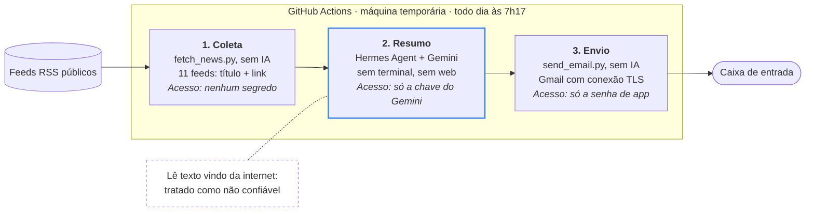
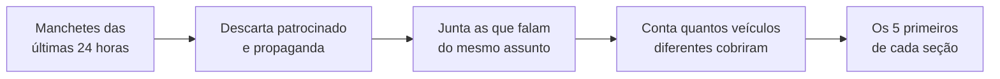

# Briefing Diário: Política e Cripto


Todo dia de manhã chega no meu email um resumo curto com os **5 assuntos mais noticiados de política** e os **5 mais noticiados de cripto** nas últimas 24 horas.

Quem escreve o resumo é o [Hermes Agent](https://github.com/NousResearch/hermes-agent), um agente de IA de código aberto da Nous Research, usando o Gemini do Google. Quem agenda e executa tudo é o GitHub Actions. O projeto não depende do meu computador ligado e não tem custo.

## O que chega no email

Exemplo ilustrativo de um tópico de cada seção:

```
POLÍTICA

1. Câmara aprova projeto X
A Câmara aprovou nesta terça o projeto X, que segue para o Senado.
Fontes: Agência Brasil, Poder360, Gazeta do Povo, CartaCapital
https://...

CRIPTO

1. ETFs de bitcoin recebem novos aportes
Fundos de bitcoin negociados em bolsa nos EUA receberam novos aportes, segundo a imprensa.
Fontes: CoinDesk, Cointelegraph, The Block
https://...
```

Cada tópico mostra quais veículos cobriram o assunto e traz um link para conferir a notícia original.

## Como funciona

O trabalho é dividido em três etapas. Só a etapa do meio usa IA. A coleta e o envio são código comum, que faz sempre a mesma coisa.



| Etapa | O que faz | Usa IA? | Acessa |
| --- | --- | :---: | --- |
| **1. Coleta** | Lê os feeds RSS e separa título e link das notícias das últimas 24 horas | Não | Nenhuma senha |
| **2. Resumo** | O Hermes segue a skill `briefing-diario` e escreve os 5 tópicos de cada seção | Sim | Só a chave do Gemini |
| **3. Envio** | Monta o email em texto simples e envia pelo Gmail | Não | Só a senha de app |

## Como o "mais falado" é escolhido

O critério é objetivo: um assunto sobe no ranking quando **mais veículos diferentes** falam dele. Várias matérias do mesmo site contam como uma só.



Para nenhum veículo decidir sozinho o que é importante, as fontes têm linhas editoriais diferentes:

| Seção | Fontes |
| --- | --- |
| **Política** | Agência Brasil, Poder360, Gazeta do Povo, CartaCapital, Câmara dos Deputados, Senado Federal |
| **Cripto** | Livecoins, CoinDesk, Cointelegraph, Decrypt, The Block |

As fontes ficam no arquivo [`feeds.txt`](feeds.txt), uma por linha, no formato `Seção | Veículo | Link do feed`. Uma linha com uma seção nova cria uma seção nova no email, sem mexer no código.

As regras que o agente segue estão em [`skills/briefing-diario/SKILL.md`](skills/briefing-diario/SKILL.md). É uma skill do Hermes no formato aberto [agentskills.io](https://agentskills.io) e funciona como um procedimento passo a passo: como agrupar e ordenar os assuntos, como escrever de forma neutra, cuidados específicos com cripto e uma lista de conferência antes de responder.

## Segurança

O ponto central do projeto: o agente lê texto que vem da internet, e esse texto pode ter sido escrito para enganá-lo. Por isso ele é tratado como uma peça não confiável e só tem acesso ao mínimo necessário.

| Risco | Proteção |
| --- | --- |
| **Instrução escondida numa manchete** (prompt injection) | Só título e link chegam ao modelo, nunca o texto completo da matéria. O texto é limpo antes (sem HTML e sem os caracteres `<`, `>` e `#`, para ninguém imitar os marcadores do prompt). O prompt e a skill avisam que manchete é dado, não ordem. |
| **Agente com poder demais** | O Hermes roda só com a ferramenta de skills (`--toolsets skills`): sem terminal e sem acesso à web. A coleta é feita por um script, não pelo agente. |
| **Vazamento de senha** | As senhas ficam nos Secrets do GitHub, guardadas com criptografia e escondidas nos logs. Cada etapa recebe só a senha que usa: a senha do email não existe na etapa do agente. O workflow só tem permissão de leitura no repositório. |
| **Conta de email exposta** | O envio usa uma senha de app, separada da senha principal da conta e que pode ser cancelada a qualquer momento. Uma conta só para o envio isolaria ainda mais; preferi a simplicidade de usar a minha. |
| **Código de terceiros comprometido** | O Hermes é instalado pelo instalador oficial, e o resumo SHA-256 do instalador fica registrado em cada execução. Os scripts em Python usam só a biblioteca padrão. |
| **Golpes e propaganda em cripto** | A skill descarta conteúdo patrocinado e promoções do tipo "airdrop grátis" e proíbe sugerir compra ou venda. Todo link do email precisa vir da lista coletada, então o agente não consegue incluir um link novo. |
| **Resumo errado ou tendencioso** | Regras de escrita neutra, declarações sempre atribuídas a quem falou e uma conferência final: cada frase precisa estar apoiada numa manchete. O aviso "não é recomendação de investimento" é colocado pelo código, não depende da IA lembrar. |
| **Feed quebrado ou malicioso** | Limite de tamanho e de tempo de download, no máximo 30 notícias por veículo e só links `https://`. Se menos de 2 fontes de uma seção responderem, a seção fica de fora em vez de sair desequilibrada. |

## Como usar no seu repositório

1. Faça um fork deste repositório e deixe ele **público**, para o GitHub Actions ser gratuito.
2. Em **Settings → Secrets and variables → Actions**, crie estes quatro Secrets:

   | Secret | O que colocar |
   | --- | --- |
   | `GEMINI_API_KEY` | Chave criada no [Google AI Studio](https://aistudio.google.com/apikey). Não precisa ativar cobrança. |
   | `GMAIL_ADDRESS` | Conta Gmail que vai enviar o email |
   | `GMAIL_APP_PASSWORD` | Senha de app dessa conta, criada em [myaccount.google.com/apppasswords](https://myaccount.google.com/apppasswords). Exige a verificação em duas etapas ativa. |
   | `EMAIL_TO` | Email que vai receber o resumo |

3. Na aba **Actions**, abra **Briefing diário (política e cripto)** e clique em **Run workflow** para testar.

### Horário

O agendamento está em [`.github/workflows/briefing.yml`](.github/workflows/briefing.yml), na linha `cron: "17 10 * * *"`. O GitHub usa o horário UTC, 3 horas a mais que Brasília, então 10h17 UTC equivale a **7h17 em Brasília**.

## Limitações conhecidas

- **Demora:** uma execução leva uns 12 minutos, provavelmente porque o plano gratuito do Gemini impõe pausas entre as chamadas.
- **Atraso no agendamento:** em horários de pico, o GitHub pode atrasar o início em até cerca de 1 hora.
- **Pausa automática:** em repositório público, o GitHub pausa o agendamento depois de 60 dias sem nenhuma alteração. Para voltar, é um clique.
- **Cobertura não é importância:** o ranking mede quantos veículos falaram do assunto, não o quanto ele importa.
- **Cripto em inglês:** quase todas as fontes de cripto são internacionais, então notícias de cripto do Brasil podem aparecer menos.
- **A IA pode errar:** a conferência reduz erros, mas não elimina. Por isso cada tópico tem o link da notícia original.

## Estrutura dos arquivos

| Arquivo | Para que serve |
| --- | --- |
| [`.github/workflows/briefing.yml`](.github/workflows/briefing.yml) | Agendamento e as etapas da execução |
| [`feeds.txt`](feeds.txt) | Fontes e seções do email |
| [`scripts/fetch_news.py`](scripts/fetch_news.py) | Coleta e limpeza das manchetes |
| [`prompts/briefing.txt`](prompts/briefing.txt) | Modelo do pedido enviado ao Hermes |
| [`skills/briefing-diario/SKILL.md`](skills/briefing-diario/SKILL.md) | Regras que o agente segue |
| [`hermes/config.yaml`](hermes/config.yaml) | Configuração do modelo (Gemini) |
| [`scripts/send_email.py`](scripts/send_email.py) | Envio do email |

## Sobre o uso de IA

Este projeto foi construído com ajuda do Claude, uma etapa de cada vez, conferindo cada resultado na documentação oficial do Hermes. Revisei todos os arquivos e sei explicar cada decisão descrita aqui.
