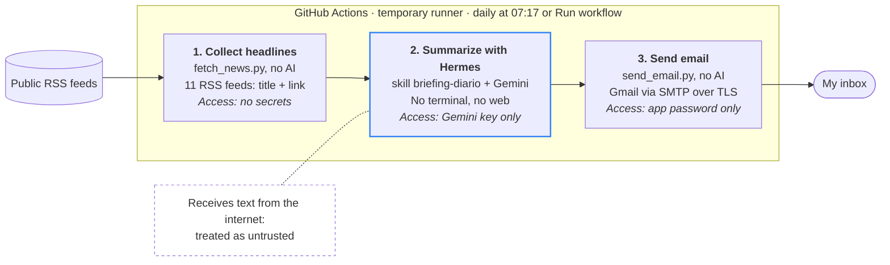

# Hermes Daily Briefing — Politics & Crypto

A daily, minimalist email with the **5 most-covered topics in Brazilian politics and the 5 most-covered topics in crypto** from the last 24 hours, written by [Hermes Agent](https://github.com/NousResearch/hermes-agent) (Nous Research) and delivered automatically by GitHub Actions.

It costs nothing to run: GitHub Actions is free for public repositories, the model runs on the Gemini API free tier, and the email goes out through a dedicated Gmail account.

## What arrives in the inbox

```
Briefing — 21/10/2026

POLÍTICA

1. Câmara aprova projeto X
A Câmara aprovou nesta terça o projeto X, que segue para o Senado.
Fontes: Agência Brasil, Poder360, Gazeta do Povo, CartaCapital
https://...

CRIPTO

1. ETFs de bitcoin recebem novos aportes
Fundos de bitcoin negociados em bolsa nos EUA receberam US$ 527 milhões, segundo dados citados pela imprensa.
Fontes: CoinDesk, Cointelegraph, The Block
https://...

—
Gerado por Hermes Agent a partir de N manchetes de N veículos.
Cripto: informativo, não é recomendação de investimento.
```

## How it works



**Each step only gets the secret it needs.** Only the middle step uses AI, and it is exactly the one that reads text from the internet, so it has no email password and no tools.

**"Most covered" is objective:** a topic ranks higher when more *different* outlets report on it. Politics mixes outlets with different editorial lines plus institutional sources (Chamber of Deputies, Senate). Crypto mixes a Brazilian outlet with the main international ones; English headlines are translated into Portuguese.

Sections come from [`feeds.txt`](feeds.txt) (`Category | Outlet | URL`). Adding a new line with a new category creates a new section in the email, no code changes needed.

The rules the agent follows live in [`skills/briefing-diario/SKILL.md`](skills/briefing-diario/SKILL.md), a Hermes skill in the open [agentskills.io](https://agentskills.io) format: how to filter sponsored content, group and rank headlines, neutral writing rules, crypto-specific rules (no investment advice, no price predictions, no hype), and a checklist the agent runs before answering.

## Security decisions

This is a small project, but it touches the same problems as any AI agent in production:

| Risk | Mitigation |
| --- | --- |
| **Prompt injection** — a headline could contain instructions aimed at the agent | Only titles and links reach the model, never article bodies. Text is sanitized (HTML stripped; `<`, `>` and `#` removed so data delimiters and section headers can't be forged). The prompt and the skill both state that headline content is data, not instructions. |
| **Agent misuse of tools** | Hermes runs with `--toolsets skills` only: no terminal, no web browsing. Collection is done by a deterministic script, not by the agent. |
| **Credential exposure** | All secrets live in GitHub Secrets (encrypted, masked in logs). The Gmail password exists **only** in the email step, so the agent step never has access to it. The workflow token is read-only (`permissions: contents: read`). |
| **Account compromise** | A dedicated Gmail account with an app password, not a personal account or its main password. |
| **Supply chain** | Hermes is installed from the official installer, and its SHA-256 is printed in every run for auditing. Python code uses only the standard library. |
| **Crypto scams and promotion** | The skill discards sponsored content, press releases and "free airdrop" items, and forbids buy/sell language. Links must be copied from the collected headlines, so the agent can't introduce a new URL. |
| **Biased or wrong output** | Neutral-writing rules, mandatory attribution of claims, and a verification step: every sentence must be backed by a headline, every link must exist in the input. |
| **Untrusted feed data** | Download size limit, timeouts, per-outlet item cap, only `https://` links accepted. A section with fewer than 2 responding sources is dropped instead of sending a lopsided summary. |

## Setup

1. Fork or create this repository (public, so Actions is free).
2. Add these **repository secrets** (Settings → Secrets and variables → Actions):

   | Secret | Value |
   | --- | --- |
   | `GEMINI_API_KEY` | Key from [Google AI Studio](https://aistudio.google.com/apikey) (no billing needed) |
   | `GMAIL_ADDRESS` | Dedicated Gmail account that sends the briefing |
   | `GMAIL_APP_PASSWORD` | App password of that account (requires 2-Step Verification) |
   | `EMAIL_TO` | Where the briefing should arrive |

3. Go to **Actions → Briefing diário (política e cripto) → Run workflow** to test it.

The schedule is `17 10 * * *` (10:17 UTC = 07:17 in Brasília). Change it in [`.github/workflows/briefing.yml`](.github/workflows/briefing.yml).

## Known limitations

- GitHub may delay scheduled runs, sometimes by up to an hour at peak times.
- GitHub pauses schedules in public repositories after 60 days without activity; re-enable with one click.
- The Gemini free tier has low quotas. One run per day fits, but heavy manual testing can hit the limit for the day.
- Ranking uses headlines only, so it measures *coverage*, not importance.
- Crypto coverage is mostly English-language international press; Brazil-specific crypto news may be underrepresented.
- Each run starts from scratch; Hermes' persistent memory is not used here.

## About AI use

This project was built with AI assistance (Claude), working step by step and checking each result against the official Hermes documentation. I reviewed every file and can explain each decision above.

## Files

```
.github/workflows/briefing.yml      schedule and pipeline
feeds.txt                           news sources and sections (editable)
scripts/fetch_news.py               RSS collection and sanitization
prompts/briefing.txt                prompt template sent to Hermes
skills/briefing-diario/SKILL.md     the Hermes skill
hermes/config.yaml                  model configuration (Gemini)
scripts/send_email.py               email delivery
```
